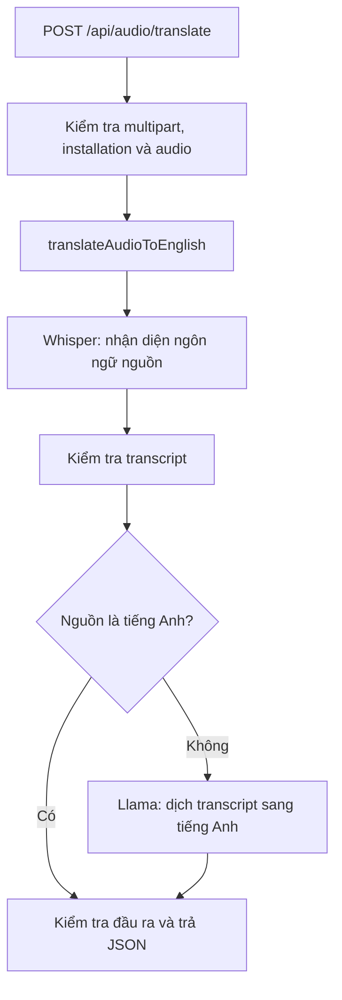
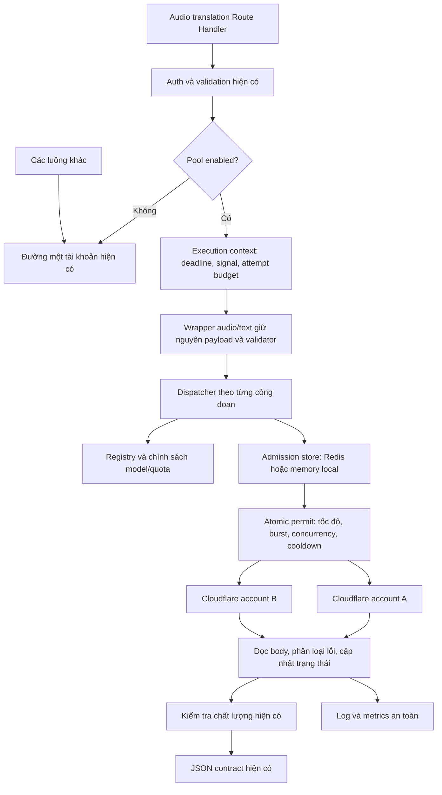

# Kiến trúc phân phối tải nhiều tài khoản Cloudflare Workers Paid

Ngày phân tích: 26/10/2026. Nhánh quan sát: `can-bang-tai`; HEAD: `6045a67`.

**Trạng thái: tài liệu thiết kế để phát triển, chưa triển khai tính năng.** Phân tích dựa trên working tree hiện tại, có cả thay đổi staged, unstaged và file chưa được Git theo dõi. Không xem nội dung này là xác nhận phiên bản đã deploy lên Railway.

**Cập nhật triển khai:** V1 đã được xây dựng ngày 26/10/2026, với feature flag mặc định tắt. Ngày 27/10 bổ sung chờ burst hữu hạn, ngân sách upload và Retry-After. Trạng thái thiết kế bên dưới là mốc ban đầu; cấu hình và giới hạn hiện hành xem [runbook](./cloudflare-multi-account-runbook.md). Pool đã được thử local, chưa deploy hoặc nghiệm thu tải production. Deadline của đường pool hiện bao gồm cả đọc upload từ lúc giữ chỗ body.

**Bổ sung thử local theo yêu cầu:** có thể cho phép account legacy cùng tham gia pool bằng `CLOUDFLARE_POOL_ALLOW_LEGACY_ACCOUNT_LOCAL_TEST=true` trong development/test với Redis loopback. Chế độ này không điều phối các caller legacy và bị chặn trong production. Đã thử hai request ASR đồng thời thực tế, một thành công qua `audio-a` và một qua `audio-b`; đây là xác nhận phân phối, chưa là kết quả load test hoặc chất lượng tiếng Việt. Xem [hướng dẫn local](./redis-local.md#thử-phân-phối-giữa-hai-account-đang-có).

## 1. Quyết định kiến trúc

Triển khai một module điều phối tài khoản riêng, bật bằng cấu hình cho **`POST /api/audio/translate` trước**. Các caller hiện có tiếp tục đi đường một tài khoản nếu không truyền ngữ cảnh điều phối mới.

Giai đoạn đầu dùng tài khoản dành riêng cho endpoint này, không đưa Account ID đang phục vụ hội thoại, luyện nghe và TTS vào pool. Đây là biện pháp tránh tranh hạn mức với tính năng cũ; tách code nhưng dùng chung Account ID vẫn có ảnh hưởng tài nguyên.

Không viết lại pipeline hội thoại, thay đổi prompt/model, sửa bộ quy tắc sửa lời nói, thay cache hoặc chuyển TTS trong cùng đợt phát triển. Khi cần chia tải toàn bộ tính năng, thực hiện giai đoạn sau với kiểm thử và phân bổ tài nguyên riêng.

Không thể cam kết tuyệt đối “không ảnh hưởng” trước khi triển khai và kiểm chứng. Tài liệu quy định ranh giới thay đổi, cơ chế tắt, kiểm thử hồi quy và điều kiện phát hành để kiểm soát ảnh hưởng có thể đo được.

## 2. Kết quả phân tích project hiện tại

### 2.1. Nền tảng và hạ tầng

| Thành phần | Quan sát trong repository | Tác động tới thiết kế |
| --- | --- | --- |
| Next.js | `16.2.11`, App Router; endpoint audio dùng Node.js runtime | Giữ Route Handler hiện có; đọc hướng dẫn Next trong `node_modules/next/dist/docs/` trước khi sửa |
| TypeScript | `strict`, alias `@/*` | Khai báo kiểu execution context và lỗi nội bộ, không dùng biến môi trường thay đổi theo request |
| Kiểm thử | `node:test` thông qua `tsx`; nhiều script kiểm thử theo nhóm | Dùng cùng hệ kiểm thử, chưa cần thêm framework |
| Lưu trữ | Có lớp PostgreSQL/Neon và các backend audio; package có Cloudinary, S3 SDK, Vercel Blob | Không dùng bảng lịch sử hoặc storage audio làm bộ đếm điều phối |
| Redis | Không thấy dependency hoặc tích hợp Redis trong mã đã khảo sát | Đây là hạ tầng mới nếu chạy bộ điều phối nhiều process/instance |
| Quan sát | `src/lib/observability.ts` có `logEvent`, `getRequestId`, `withRequestId` | Tái sử dụng từ facade server, chỉ log metadata an toàn |
| Hạn mức hiện có | Registration và upload chunk có bộ đếm trong bộ nhớ | Khác mục đích, không thay hoặc tái sử dụng làm hạn mức provider |

### 2.2. Luồng audio translation đang có



| File hiện có | Trách nhiệm và bằng chứng cần giữ |
| --- | --- |
| `src/app/api/audio/translate/route.ts` | Parse multipart, kiểm tra kích thước/định dạng/ngôn ngữ, `requireInstallationAccess`, gắn request ID, chuyển lỗi thành HTTP response; `maxDuration = 35` |
| `src/lib/ai/cloudflareWorkersAi.ts` | `translateAudioToEnglish`, `transcribeAudioToVietnamese`, `transcribeAudioToEnglish`; đọc một Account ID/token từ env |
| `src/lib/ai/cloudflareWorkersAiRequest.ts` | Builder payload audio, chính sách VAD và phân loại transcript rỗng |
| `src/lib/ai/cloudflareText.ts` | Gọi chat completions, giữ model, prompt, giới hạn token và timeout văn bản |
| `src/lib/ai/audioTranslationQuality.ts` | Guard phát hiện một số đầu ra không hợp lệ; không chứng minh đúng nghĩa |
| `src/lib/ai/vietnameseTranscriptValidation.ts` | Kiểm tra transcript tiếng Việt và thông tin độ tin cậy |
| `src/lib/errors.ts`, `src/lib/appError.ts` | Public error envelope và lớp lỗi dùng chung; `details` của AppError có thể được đưa ra response |

Các điểm đã xác nhận trong working tree:

- Audio translation mặc định dùng `@cf/openai/whisper-large-v3-turbo` để **transcribe**, sau đó dùng `@cf/meta/llama-4-scout-17b-16e-instruct` để dịch văn bản. Nguồn `en` bỏ qua lần gọi dịch text.
- `.env.local` không ghi đè hai tên model này trong lần kiểm tra. Các biến môi trường trên Railway hoặc process khác chưa được xác nhận.
- Deadline audio translation lấy từ `CLOUDFLARE_AUDIO_TRANSLATION_TIMEOUT_MS`, mặc định 20.000 ms, cap 30.000 ms; tín hiệu này dùng qua cả hai bước. Text còn có timeout riêng, mặc định 6.000 ms. Các giá trị cần được giữ khi feature flag tắt.
- ASR dùng cho hội thoại có timeout và VAD policy riêng; không dùng timeout 20 giây làm mặc định cho mọi ASR.
- Log 429/4006 chưa đủ để kết luận là hết Neurons hay vượt RPM. Không gán ý nghĩa cụ thể cho mã chưa được xác nhận.

### 2.3. Các tính năng cùng phụ thuộc Cloudflare

| Luồng | Đường gọi quan trọng | Rủi ro nếu sửa mặc định dùng chung |
| --- | --- | --- |
| Hội thoại tiếng Anh | `conversation/route.ts` → `pipeline.ts` → `asr.ts`, `llm.ts` → các wrapper Cloudflare | Tăng latency, thay error handling hoặc phá fast lookup |
| Hội thoại ngôn ngữ khác | `runTargetLanguageConversationPipeline` → `asr.ts`, gọi trực tiếp `translateVietnameseWithCloudflare` và TTS đích | Đổi credentials/timeout chung có thể ảnh hưởng dịch và phát âm |
| Audio session preview/finalize | `audioSessionPipeline.ts`, route preview/finalize, `asr.ts`, `pipeline.ts` | Ảnh hưởng việc dùng chung kết quả đang xử lý, thứ tự finalize và persistence |
| Conversation prepare/commit/finalize | `conversationPreparation.ts` và các route prepare | Cần kiểm chứng theo toàn bộ luồng, không chỉ endpoint đơn lẻ |
| Bài luyện nói tiếng Anh | `listening/evaluate-attempt/route.ts` → `transcribeAudioToEnglish` | Phải giữ transcript tiếng Anh và kết quả `matched` |
| Nhận diện lựa chọn, AI review, TTS | `aiProvider.ts`, `tts.ts`, các caller recognize-choice/review/audio stream | Lớp provider khác vẫn đọc cùng Account ID/token hiện tại |
| Cache/rules/prefetch | `llm.ts`, `textCache.ts`, `singleFlight.ts`, `batchPrefetch.ts` | Không phá cache key, quy tắc đã duyệt hoặc tạo thêm request provider |
| Realtime session | `realtime/transcription-session/route.ts` | Hiện trả 410; không vô tình bật lại |
| Installation/admin/storage | Auth, proxy, history, upload, cleanup, TTS cache | Giữ nguyên quyền truy cập, schema và chính sách lưu trữ |

Lưu ý: `aiProvider.ts` có đường gọi riêng cho ASR/text/TTS; mặc định text tại đây khác wrapper `cloudflareText.ts` khi env không được đặt. Không gom hai cấu hình hoặc “chuẩn hóa model” trong đợt chia tải vì sẽ thay đổi hành vi của tính năng khác.

### 2.4. Baseline chất lượng cần xử lý

`docs/audio-translation-optimization.md` ghi rõ bản audio translation hiện tại là thử nghiệm local, **chưa đạt kiểm tra đúng nghĩa** trên các audio trẻ em đã dùng. Có mẫu trả tiếng Anh nhưng sai nghĩa và mẫu bị từ chối vì độ tin cậy thấp.

Phân phối tài khoản không sửa được lỗi nhận diện hoặc dịch sai nghĩa. Dev phải tách hai tiêu chí: hồi quy so với baseline và chất lượng sản phẩm đủ để phát hành. Không dùng việc giữ nguyên baseline để coi chất lượng hiện tại là đạt. Không đưa bản chia tải lên production chỉ vì unit test và HTTP 200 đều đạt.

## 3. Phạm vi và cách cô lập ảnh hưởng

### 3.1. Giai đoạn 1: chỉ audio translation

- Feature flag mặc định tắt: `CLOUDFLARE_AUDIO_TRANSLATION_POOL_ENABLED=false`.
- Chỉ route audio translation tạo execution context cho pool, sau khi kiểm tra auth và input.
- Caller không truyền execution context tiếp tục dùng config và đường gọi một tài khoản như trước.
- Khi flag tắt: không parse secrets pool, không yêu cầu Redis, không kết nối Redis, không thêm retry/cooldown hoặc đổi lỗi cũ.
- Khi flag bật nhưng cấu hình pool sai: trả lỗi cấu hình cho endpoint được bật; không làm các route khác hoặc quá trình build thất bại do khởi tạo pool ở module top level.
- Không cho client chọn account, sửa timeout/pool flag hoặc đưa credential vào multipart.
- Giữ các biến `CLOUDFLARE_ACCOUNT_ID` và `CLOUDFLARE_WORKERS_AI_API_TOKEN` cho luồng cũ. Không xoay hoặc ghi đè chúng để đổi tài khoản theo request.

### 3.2. Cô lập tài nguyên

Pool giai đoạn 1 không chứa Account ID legacy đang phục vụ các tính năng khác. Kiểm tra trùng Account ID thực, không chỉ alias hay token; nhiều token cùng tài khoản không tạo thêm slot quota.

- Hai tài khoản tổng cộng: có thể dành tài khoản cũ cho tính năng cũ, tài khoản mới cho endpoint; lúc này pool endpoint có một tài khoản và chưa có dự phòng giữa hai tài khoản.
- Muốn pool endpoint có hai tài khoản đồng thời giữ tài khoản cũ riêng: cần hai tài khoản dành cho pool, ngoài tài khoản legacy.
- Nếu muốn chia sẻ Account ID cũ: phải mở rộng mọi đường gọi liên quan qua bộ điều phối và phân bổ quota theo workload. Đây là giai đoạn 2, không thể coi là hoàn toàn độc lập với tính năng cũ.

Ngay cả khi tách tài khoản, hạ tầng model của Cloudflare và tài nguyên CPU/RAM/network của backend vẫn có thể dùng chung. Cần giới hạn tổng request audio đang xử lý trên mỗi instance và tổng số permit trong pool, tránh giữ quá nhiều buffer audio/base64 khi burst.

## 4. Sơ đồ kiến trúc đề xuất



Model, prompt và chất lượng đầu ra thuộc wrapper nghiệp vụ. Chọn tài khoản, kiểm soát tài nguyên và retry thuộc dispatcher. Redis chỉ lưu metadata điều phối; không lưu audio, transcript hoặc token.

## 5. Kiến trúc file sẽ xây dựng

Tất cả file dưới đây là **đề xuất**, chưa được tạo, ngoại trừ tài liệu này. File test đặt cạnh module theo convention đang dùng.

```text
src/lib/ai/cloudflare/
  types.ts
  accountConfig.ts
  quotaPolicy.ts
  providerError.ts
  deadline.ts
  admissionStore.ts
  memoryAdmissionStore.ts
  redisClient.ts
  redisAdmissionStore.ts
  redisScripts.ts
  dispatcher.ts
  telemetry.ts
  runtime.ts
  accountConfig.test.ts
  quotaPolicy.test.ts
  providerError.test.ts
  deadline.test.ts
  memoryAdmissionStore.test.ts
  dispatcher.test.ts
  runtime.test.ts
  redisAdmissionStore.integration.test.ts

src/lib/ai/cloudflareMultiAccountCompatibility.test.ts
src/app/api/audio/translate/route.test.ts
scripts/check-cloudflare-pool.ts
scripts/benchmark-cloudflare-pool.ts
docs/cloudflare-multi-account-runbook.md
```

### 5.1. Trách nhiệm từng module

| File mới | Trách nhiệm | Giới hạn trách nhiệm |
| --- | --- | --- |
| `types.ts` | Account, operation, execution context, quota rule, permit, outcome và provider fault | Không đọc env, gọi mạng hoặc import code Next |
| `accountConfig.ts` | Parse registry, tham chiếu token bằng tên env; validate model/capability, alias/Account ID trùng; cấu hình bất biến | Không mutate `process.env`; lỗi cấu hình chỉ khi pool được khởi tạo |
| `quotaPolicy.ts` | Tạo tập quota rule cho account/task/model, rate, burst, concurrency, cooldown và retry budget | Không hard-code hạn mức tài khoản thực hoặc coi mọi quota đều theo model |
| `providerError.ts` | Chuẩn hóa lỗi từ status, safe codes, Retry-After và nguyên nhân mạng; tạo public projection an toàn | Không xuất raw body, URL chứa Account ID, token hoặc thông tin pool ra response |
| `deadline.ts` | Quản lý deadline tổng, remaining budget, tín hiệu hủy và attempt budget | Retry không được tạo lại deadline tổng |
| `admissionStore.ts` | Interface lấy permit, hoàn tất outcome, snapshot và trạng thái cooldown | Không phụ thuộc cụ thể vào Redis |
| `memoryAdmissionStore.ts` | Store đơn process để dev/test, clock inject được, cleanup giới hạn bộ nhớ | Không dùng để cam kết hạn mức nhiều instance production |
| `redisClient.ts` | Tạo client lười, timeout kết nối/lệnh, đóng kết nối trong script/test; không log secret URL | Không kết nối ngay khi import, không ảnh hưởng legacy |
| `redisAdmissionStore.ts` | Triển khai store bằng thao tác nguyên tử, Redis TIME, permit TTL và xử lý NOSCRIPT | Không rơi về memory hoặc legacy khi Redis production lỗi |
| `redisScripts.ts` | Lua ngắn để kiểm tra tất cả quota, cấp lease, ghi outcome/cooldown và giải phóng lease | Script phải có thời gian thực thi và số key hữu hạn |
| `dispatcher.ts` | Lọc account hợp lệ, thử cấp permit, thực thi callback đã đọc body, retry có giới hạn, hoàn tất lease | Không dịch text, sửa transcript hoặc tự chọn model khác |
| `telemetry.ts` | Tạo event/metric fields theo allowlist, truyền sink inject được | Không log audio/transcript/credentials; không tạo nhãn metric theo requestId |
| `runtime.ts` | Facade server ghép registry, store, dispatcher, logger; tạo context đúng scope | Import một chiều từ các wrapper; không để core import ngược wrapper/route gây cycle |
| `check-cloudflare-pool.ts` | Kiểm tra cấu hình/Redis; mặc định không gọi inference; mode smoke phải bật rõ | Chỉ in alias và kết quả an toàn, không in token hoặc toàn bộ env |
| `benchmark-cloudflare-pool.ts` | Burst và tải liên tục, dùng audio/reference manifest; tách kết quả thành công/thất bại | Tách với benchmark cũ để giữ baseline; mặc định mục tiêu local/staging |
| `cloudflare-multi-account-runbook.md` | Cách thêm/disable tài khoản, cấu hình, quan sát, incident và rollback | Chỉ placeholders, không chứa secrets |

Các module core thuần được unit test trực tiếp bằng Node. Facade server có thể dùng `server-only`, nhưng unit test core không import facade hoặc `observability.ts` kéo môi trường Next vào test. Mạng, clock và logger inject được để kiểm thử có tính quyết định.

### 5.2. File hiện có cần sửa có giới hạn

| File | Thay đổi dự kiến | Yêu cầu tương thích |
| --- | --- | --- |
| `src/app/api/audio/translate/route.ts` | Chọn legacy/pool sau validation; tạo context với requestId, client cancellation và deadline; public error mapping cho pool | Giữ multipart, auth, validation, JSON, request ID; không thêm endpoint mới |
| `src/lib/ai/cloudflareWorkersAi.ts` | Thêm tham số tùy chọn thứ ba cho `translateAudioToEnglish`; gọi dispatcher ở đúng bước ASR và chuyển context sang text | Không thay mặc định của `transcribeAudioToVietnamese`/`transcribeAudioToEnglish` |
| `src/lib/ai/cloudflareText.ts` | Mở rộng options thứ tư bằng execution context tùy chọn; dùng tài khoản được cấp khi có context | Giữ chữ ký cũ, model/prompt/tokens, timeout và error class ở legacy |
| Hai file wrapper trên | Tách resolver model/timeout thuần nếu cần để pooled mode không bắt buộc legacy token | Getter config cũ vẫn tồn tại và trả cùng giá trị; không đọc nhầm token legacy trong pooled mode |
| `.env.example` | Thêm cấu hình pool với flag tắt và placeholders; giữ biến cũ | Không đổi giá trị mặc định của cấu hình khác |
| `package.json`, `package-lock.json` | Thêm một Redis client nếu triển khai Redis; thêm script test/check/benchmark riêng | Chọn phiên bản tương thích runtime, không nâng Next/React hoặc framework test trong cùng đợt |
| Test Cloudflare hiện có | Bổ sung assertions tương thích nếu cần, không nới lỏng assertions để che hồi quy | Giữ các kỳ vọng legacy, không đổi snapshot theo kết quả mới chưa được duyệt |

Không cần sửa schema database, UI, mobile app, collection Postman hay các route hội thoại để bật giai đoạn 1. Không đổi builder `cloudflareWorkersAiRequest.ts`, prompt, VAD, beam size, bộ lọc độ tin cậy hoặc cache key trong cùng thay đổi.

## 6. Giao diện nội bộ và vòng đời một request

Chữ ký minh họa cho thiết kế, không phải code đã tồn tại:

```ts
type CloudflareOperation = "audio_translation_asr" | "audio_translation_text";

type CloudflareExecutionContext = {
  requestId: string;
  workload: "audio-translate";
  deadlineAt: number;
  signal: AbortSignal;
  attempts: AttemptBudget;
  dispatcher: CloudflareDispatcher;
};

// Chữ ký cũ vẫn hoạt động nếu không truyền execution.
translateAudioToEnglish(audio, sourceLanguage, { execution }?);
translateVietnameseWithCloudflare(text, instructions, maxTokens, { signal, execution }?);

dispatcher.execute<T>(
  { context, operation, model },
  async ({ account, signal }) => {
    // Build URL/Authorization từ account được cấp.
    // Gửi đúng payload cũ; đọc hết body trong signal/deadline.
    // Chuyển provider failure thành lỗi nội bộ có cấu trúc.
    // Trả dữ liệu đã đọc/parse, không trả raw Response chưa đọc body.
    return parsedProviderResult;
  },
);
```

Quy trình:

1. Parse và xác thực request bằng logic hiện có; request không hợp lệ không tiêu tốn permit Cloudflare.
2. Legacy: gọi đường hiện tại. Pool: tạo context riêng của request, không lưu signal/requestId trong singleton dùng chung.
3. ASR: dispatcher xin permit của account hỗ trợ đúng model/task; callback gọi provider và đọc hết body.
4. Ghi outcome/cooldown và giải phóng lease trong finally có giới hạn thời gian; giữ nguyên quota đã tiêu thụ nếu request đã được gửi.
5. Chạy validator transcript hiện có bên ngoài cơ chế retry provider. Transcript rỗng/độ tin cậy thấp không đánh dấu account hỏng.
6. Nếu cần dịch, chọn account cho bước text độc lập; không giữ slot ASR trong lúc dịch. Có thể chọn account khác; không cần session sticky giữa hai bước.
7. Giữ nguyên validator ngôn ngữ và kết quả; route chỉ nhận metadata public cũ. Account alias, permit, attempts, cooldown ở log nội bộ.
8. Lỗi text không chạy lại ASR đã hoàn tất; request client bị hủy ngăn bước tiếp theo và retry mới.

Wrapper phải không làm mất loại lỗi nội bộ trước khi dispatcher xử lý. Sau khi hết retry/budget, chuyển lỗi một lần sang `AppError` hoặc `CloudflareTextProviderError` tương thích. Không đưa nguyên object internal fault vào `AppError.details` vì `toErrorResponse` có thể công khai trường đó.

## 7. Hạn mức, permit và nhiều instance

### 7.1. Quy tắc quota

Mỗi lựa chọn account phải thỏa **tất cả** quota rule liên quan: account tổng nếu có, nhóm task, model, tốc độ và concurrency. Ví dụ hai model ASR cùng tài khoản không được mỗi model tự nhận toàn bộ quota task nếu Cloudflare áp dụng quota chung theo task.

Giới hạn chính xác là dữ liệu cấu hình do vận hành xác nhận, không suy ra từ số token hoặc số tài khoản. Dữ liệu công bố tại ngày phân tích: ASR mặc định 720 RPM, Text Generation mặc định 300 RPM với ngoại lệ cho model bắt buộc Paid. Đây không phải số user đồng thời hoặc bảo đảm burst/latency. Luồng dùng Llama để dịch vẫn là Text Generation. Xem nguồn cuối tài liệu và xác nhận hạn mức thực với Cloudflare.

V1 có thể dùng token bucket với rate nhỏ hơn hạn mức đã xác nhận và burst nhỏ được cấu hình; không mặc định burst = cả phút quota. Token bucket là chính sách bảo vệ nội bộ, không khẳng định giống cửa sổ Cloudflare. Nếu Cloudflare yêu cầu giới hạn mọi cửa sổ 60 giây, bổ sung sliding-window guard trong store và kiểm thử biên cửa sổ.

Chọn account: loại disabled/cooldown/model không hỗ trợ, xếp theo tải tương đối và quota khả dụng, xoay điểm bắt đầu để tránh mọi instance luôn chọn A. Snapshot chỉ gợi ý; phép cấp permit nguyên tử mới là quyết định cuối. Không cần thuật toán cân bằng phức tạp ở V1.

### 7.2. Redis nguyên tử và TTL

- Cấp phép bằng Lua: dùng thời gian Redis, dọn lease hết hạn trong phạm vi hữu hạn, kiểm tra cooldown và mọi quota, trừ budget và tạo lease ID duy nhất trong cùng thao tác nguyên tử.
- Hạn chế tốc độ tính cho từng lần thực sự thử gửi provider, kể cả retry. Nếu gửi thất bại với trạng thái không chắc chắn, không hoàn lại RPM một cách lạc quan.
- `complete(leaseId, outcome)` ghi trạng thái lỗi/cooldown trước khi cho phép nhận thêm việc, đồng thời giải phóng đúng lease. Idempotent; complete cũ không xóa lease mới.
- Lease TTL dài hơn deadline attempt và grace hữu hạn; process chết không giữ slot vĩnh viễn. Không dùng bộ đếm tăng/giảm đơn giản có thể âm hoặc kẹt khi process chết.
- Redis Cluster: key mà một script chạm phải chung hash slot theo account. Cấp phép nguyên tử theo từng account, không giả định giao dịch nguyên tử trên tất cả account.
- Dùng account identity ổn định từ Account ID, không từ alias/token. Hai deployment cùng chia sẻ tài khoản phải dùng cùng namespace quota; không nhân quota bằng cách đổi namespace theo environment. Test dùng namespace và account giả độc lập.
- Redis command timeout có thể có kết quả không chắc chắn: không cấp lại permit cùng request mù quáng; dùng lease ID/idempotency và TTL để phục hồi, chấp nhận giữ dư slot ngắn hạn hơn là phát vượt tải.
- Redis lỗi trong pooled production: trả lỗi dịch vụ có kiểm soát cho workload pool; không tự rơi về memory, không gửi thẳng vào tài khoản legacy.
- Store chỉ giữ timestamp, counters, hash identity, lease, cooldown và thống kê không nhạy cảm. Không có credential hoặc audio trong Redis.

### 7.3. Hàng đợi và bộ nhớ

V1 không có hàng đợi dài hoặc job nền. Có thể chờ permit một khoảng ngắn hữu hạn; mặc định ưu tiên trả sớm khi hết khả năng nhận. Có giới hạn số request chờ theo instance và tổng pool nếu bật chờ. Không đặt setTimeout dài cho hàng nghìn buffer audio.

Admission pool cần giới hạn tổng concurrency ở workload; việc Route Handler vẫn cần đọc multipart trước provider là rủi ro bộ nhớ cần đo. Nếu burst upload đã làm đầy RAM, cần một thay đổi riêng cho admission trước upload/giới hạn proxy; không thay validation upload và auth trong đợt này mà không có kiểm thử riêng.

## 8. Timeout, lỗi và retry

### 8.1. Deadline

- Giữ budget audio translation hiện tại: 20 giây mặc định, cap 30 giây; text vẫn có trần riêng 6 giây mặc định.
- Chia thời gian thành: kiểm tra đầu vào/upload, chờ permit, ASR, dịch text, retry, đọc body và hoàn tất response. Deadline của context bao gồm mọi phần kể từ lúc tạo context; thời gian upload trước đó được đo riêng trong end-to-end latency.
- `remainingMs` lấy từ cùng deadline, không reset ở account tiếp theo. Mỗi attempt dùng nhỏ nhất của thời gian còn lại và timeout công đoạn/attempt được cấu hình.
- Muốn chuyển tài khoản sớm hơn khi ASR chậm cần cấu hình attempt budget riêng sau khi đo; không mặc định hạ timeout ASR xuống vài giây rồi coi số 504 tăng là thành công.
- `maxDuration = 35` trong source không chứng minh Railway sẽ thực thi đúng giới hạn đó. Kiểm tra timeout proxy/server/deployment, giữ đủ thời gian trả lỗi và cleanup.
- Hủy fetch không chứng minh upstream đã ngừng tính toán; timeout retry có thể trùng xử lý và chi phí. V1 mặc định không retry timeout/mạng có trạng thái không chắc chắn.

### 8.2. Chính sách lỗi đề xuất

| Sự kiện | Ảnh hưởng account | Hành vi |
| --- | --- | --- |
| 429 xác nhận rate limit | Cooldown theo đúng phạm vi quota, ưu tiên Retry-After | Có thể chọn account khác một lần nếu policy Cloudflare và budget cho phép |
| 429/4006 chưa rõ nguyên nhân | Cooldown ngắn có giới hạn, log mã và safe reason | Không khẳng định hết tiền/quota, không xoay vô hạn qua toàn pool |
| Lỗi quota/billing/credential đã xác nhận | Disable/cooldown dài đúng scope, cảnh báo vận hành | Không polling inference liên tục; sửa cấu hình hoặc điều kiện tài khoản |
| Provider 5xx/capacity | Ghi outcome theo scope model/task phù hợp | Mặc định không retry tự động V1; chỉ bật thử tài khoản khác sau đánh giá tải/chi phí |
| Timeout hoặc lỗi mạng | Ghi latency và trạng thái upstream không chắc chắn | Trả lỗi theo deadline; không mặc định phát thêm bản sao request |
| Input 4xx, transcript rỗng/422, sai ngôn ngữ | Không phạt sức khỏe account | Trả lỗi nghiệp vụ như trước, không chạy lại trên mọi tài khoản |
| Client hủy request | Không coi là account hỏng | Hủy local, không gọi công đoạn tiếp hoặc retry |
| Redis/config pool lỗi | Không fallback vào legacy | 503 có envelope tương thích, log nguyên nhân nội bộ |

V1 giới hạn tối đa hai attempt cho một công đoạn và tối đa ba lần gọi inference cho cả request. Chỉ retry khi thời gian còn lại đủ cho một attempt có ích; text lỗi không chạy lại ASR. Không có hedging/gửi song song cùng audio mặc định.

Không đưa khả năng truy cập model chưa được cấp phép sang retry lỗi input. Model capability phải được xác nhận trước khi account được enable; health probe định kỳ không liên tục gọi AI làm tốn quota. Sau cooldown chỉ cho một probe có kiểm soát bằng permit để tránh nhiều instance cùng đánh thức account.

## 9. Cấu hình đề xuất

Đây là cấu hình **sẽ bổ sung**, chưa có hiệu lực trong code hiện tại. Giá trị quota là ví dụ bảo thủ để staging đo và tinh chỉnh, không là hạn mức được cấp cho tài khoản thực.

```dotenv
# Giữ nguyên credentials legacy cho tính năng cũ.
CLOUDFLARE_ACCOUNT_ID=
CLOUDFLARE_WORKERS_AI_API_TOKEN=

# Mặc định tắt. Pool chỉ áp dụng cho audio/translate ở V1.
CLOUDFLARE_AUDIO_TRANSLATION_POOL_ENABLED=false
CLOUDFLARE_POOL_STORE=redis
CLOUDFLARE_POOL_REDIS_URL=
CLOUDFLARE_POOL_NAMESPACE=speaking-ai-cf-quota-v1
CLOUDFLARE_POOL_MAX_ATTEMPTS_PER_STAGE=2
CLOUDFLARE_POOL_MAX_ATTEMPTS_PER_REQUEST=3
CLOUDFLARE_POOL_MAX_WAIT_MS=0

# JSON bên dưới chỉ tham chiếu tên biến chứa token.
CLOUDFLARE_POOL_A_TOKEN=
CLOUDFLARE_POOL_B_TOKEN=
```

Nội dung minh họa cho secret/config `CLOUDFLARE_ACCOUNTS_JSON` (dùng JSON một dòng hoặc định dạng secret mà deployment hỗ trợ):

```json
[
  {
    "alias": "audio-a",
    "accountId": "<DEDICATED_ACCOUNT_A_ID>",
    "apiTokenEnv": "CLOUDFLARE_POOL_A_TOKEN",
    "enabled": true,
    "capabilities": {
      "asr": ["@cf/openai/whisper-large-v3-turbo"],
      "text": ["@cf/meta/llama-4-scout-17b-16e-instruct"]
    },
    "limits": {
      "asr": { "rpm": 600, "burst": 10, "maxConcurrent": 10 },
      "text": { "rpm": 240, "burst": 4, "maxConcurrent": 4 },
      "accountMaxConcurrent": 14
    }
  },
  {
    "alias": "audio-b",
    "accountId": "<DEDICATED_ACCOUNT_B_ID>",
    "apiTokenEnv": "CLOUDFLARE_POOL_B_TOKEN",
    "enabled": true,
    "capabilities": {
      "asr": ["@cf/openai/whisper-large-v3-turbo"],
      "text": ["@cf/meta/llama-4-scout-17b-16e-instruct"]
    },
    "limits": {
      "asr": { "rpm": 600, "burst": 10, "maxConcurrent": 10 },
      "text": { "rpm": 240, "burst": 4, "maxConcurrent": 4 },
      "accountMaxConcurrent": 14
    }
  }
]
```

Schema cần mở rộng được quota theo model khi Cloudflare cấp giới hạn riêng. Tất cả số phải hữu hạn, dương và có trần an toàn. Không lấy hạn mức từ multipart hoặc public header.

Các số minh họa trên **không được dùng để hứa xử lý 100 user trong 5 giây**. Tổng năng lực thực phụ thuộc hạn mức được xác nhận, latency, độ dài audio và những consumer khác. Hai tài khoản không mặc định đủ cho tải 2.196 request/phút đã quan sát.

## 10. Contract và bảo vệ tính năng cũ

### 10.1. Contract endpoint

- Giữ POST và multipart: `audio`, `sourceLanguage`, `clientId`; giữ mặc định ngôn ngữ và danh sách định dạng/kích thước hiện có.
- Giữ installation auth như cấu hình hiện tại; không yêu cầu bật/tắt auth để dùng pool.
- Response thành công giữ `requestId`, `sourceLanguage`, `targetLanguage`, `englishText`, `sourceText`, `textModel`, `timings`, `wordCount`, `model` theo shape hiện tại, kể cả tính tùy chọn khi nguồn `en`.
- Không trả token/account ID/alias vào response. Không biến transcript tiếng nguồn thành subtitle tiếng Anh.
- Giữ envelope `error: { code, message, requestId, details? }` và `X-Request-Id`. Với pool hết permit có thể dùng 429, với hạ tầng pool lỗi 503; phải dùng mã lỗi đã có hoặc thống nhất hợp đồng trước khi thêm mã mới.
- `Retry-After` chỉ thêm khi có cơ sở thời gian retry; không đẩy Retry-After của một account lên client nếu account khác vẫn có thể xử lý.
- Không đổi `toErrorResponse` hoặc toàn bộ union `ApiErrorCode` chỉ để hỗ trợ metadata nội bộ. Nếu bắt buộc đổi public contract, tách thành thay đổi được đánh giá riêng.

### 10.2. Ma trận không hồi quy

| Phạm vi | Bất biến cần kiểm tra |
| --- | --- |
| Legacy audio translate, flag OFF | URL upstream, Authorization, payload, số call, deadline, response/error như baseline; config pool hỏng không gây ảnh hưởng |
| Hội thoại EN và ngôn ngữ khác | Account legacy, prompt/model, fast lookup, sửa transcript, TTS và error mapping không đổi |
| Session preview/finalize/prepare | Vẫn chỉ dùng kết quả xử lý chung như trước; replay/finalize không tạo thêm ASR/TTS vì pool |
| Luyện nghe/nói | Transcript/matched và account không đổi; realtime vẫn 410 |
| Cache/rules | Key/version, hit/miss, single-flight và thứ tự lưu không đổi |
| TTS/audio stream/warmup | Profile, voice, tốc độ, caching, stream headers, fallback hiện có không đổi |
| Auth/proxy/admin/storage | Không thay quyền, cookie, CORS, upload token, persistence và cleanup |
| Secrets/build | Không secrets trong client bundle/log/error; không khởi tạo Redis trong build hoặc legacy request |

## 11. Kiểm thử cần phát triển và điều kiện nghiệm thu

### 11.1. Unit và integration

| Nhóm file | Tình huống bắt buộc |
| --- | --- |
| `accountConfig.test.ts` | Config sai, token thiếu, account ID trùng/đổi alias, account legacy lẫn pool, model thiếu capability; flag OFF bỏ qua pool |
| `quotaPolicy.test.ts`, `memoryAdmissionStore.test.ts` | RPM và burst riêng, quota task/model cùng áp dụng, concurrency, nhiều loại task cùng account, cooldown, hết TTL, biên cửa sổ |
| `providerError.test.ts` | Retry-After số/ngày HTTP, giá trị không hợp lệ, 429/4006 chưa rõ, 401/403, 5xx, network/timeout; projection không rò secrets |
| `deadline.test.ts`, `dispatcher.test.ts` | Không reset deadline, max attempts toàn request, text retry không lặp ASR, body đọc chậm, client abort, callback throw, cleanup thất bại |
| `redisAdmissionStore.integration.test.ts` | Ít nhất hai process cùng tranh quota; không cấp vượt; Lua/cooldown nguyên tử, lease hết hạn, complete lặp/cũ, NOSCRIPT, Redis chết/lệnh timeout |
| `runtime.test.ts` | Khởi tạo lười, pooled config không phụ thuộc token legacy; flag OFF không kết nối Redis; pool lỗi không fallback tài khoản cũ |
| `cloudflareMultiAccountCompatibility.test.ts` | Caller cũ không truyền context giữ hành vi; execution context không rò giữa hai request; không phát sinh call ngoài pool |
| `route.test.ts` | Multipart/auth/input invalid, source `en`, shape success/error, pool hết khả năng nhận, Redis lỗi, X-Request-Id, flag OFF tương thích |

Test thuần dùng clock/fetch/store giả, không cần token thật và không gọi Cloudflare. Redis integration dùng Redis test riêng với namespace riêng, không chạy vào Redis production. Test route có thể dùng harness Next hoặc module mock phù hợp; không bỏ auth để làm test chạy.

### 11.2. Script kiểm thử hiện có

Trước khi sửa code: lưu baseline và chạy lại sau mỗi nhóm thay đổi liên quan. Trước rollout cần chạy các nhóm phù hợp dưới đây; không coi danh sách là kết quả đã chạy:

```powershell
npm run test:cloudflare
npm run test:cloudflare-text
npm run test:ai-provider
npm run test:cloudflare-only
npm run test:translation
npm run test:transcript
npm run test:tts-cache
npm run test:storage
npm run test:installation-auth
npm run test:admin-auth
npm run test:proxy
npm run test:app-version
npm run lint
npm run build
```

`test:storage` và smoke test nghiệp vụ phải dùng dữ liệu/môi trường test riêng. Nếu baseline đã có lỗi, ghi nhận trước; không che bằng cách bỏ test hoặc sửa tính năng khác ngoài scope. Đọc Next docs trong dependency trước khi sửa route.

### 11.3. Chất lượng và load test thực

1. Trước hết kiểm tra đúng nghĩa trên bộ audio có reference, gồm giọng trẻ, âm thanh nhỏ/nhiễu, câu ngắn, phủ định, chủ thể và nhiều định dạng. Không dùng tên file làm đáp án, không chỉ kiểm tra đầu ra có chữ Latin hoặc `targetLanguage = en`.
2. So sánh legacy với pool một tài khoản và pool nhiều tài khoản bằng cùng model, payload, dataset và điều kiện triển khai. Không lẫn việc thay model/prompt với hiệu quả chia tải.
3. Chạy riêng burst: 20 rồi 100 client, mỗi client gửi đúng một request. Đo độ lệch thời điểm gửi thực tế; không gọi các request lặp trong 2 phút là “100 request duy nhất cùng lúc”.
4. Chạy riêng tải liên tục: 20/50/100 VU và đo attempted rate, admitted rate, success rate, 429/422/5xx, queue time, provider time, P50/P95/P99 của request thành công và end-to-end.
5. Kiểm tra account A bị 429/timeout, mọi account hết quota, Redis mất kết nối và process bị kill. Dùng mock/staging cho các sự cố không thể tạo an toàn trên provider thật.
6. Chạy feature cũ đồng thời dưới tải pool; so sánh latency/error trước và sau. Tách tài khoản chưa loại bỏ tranh CPU/RAM/network của backend.
7. Không báo cải thiện tốc độ dựa trên request lỗi nhanh. Failure assertion khác lỗi kết nối; thống kê tỷ lệ dịch đúng nghĩa riêng.
8. Chạy với audio khác nhau hoặc ghi riêng cache hit/miss; quan sát máy tạo tải. Các số CPU/RAM trong Postman thuộc máy tạo tải, cần metrics Railway riêng cho backend.

Mục tiêu tham khảo để thương lượng: 100 user đồng thời, P95 bản dịch đúng nghĩa trong 5 giây, tỷ lệ thành công ít nhất 99% trên input hợp lệ của workload đã định nghĩa. Đây là **mục tiêu chưa đạt/chưa được xác nhận**, không là cam kết từ thiết kế. Phải xác định độ dài audio, burst so với tải liên tục và hạn mức provider đủ trước khi chấp nhận.

## 12. Kế hoạch triển khai và rollback

| Bước | Công việc | Điều kiện chuyển bước |
| --- | --- | --- |
| 0 | Chụp baseline code/contract/test và chất lượng; xác nhận support/hạn mức từng account, model và burst | Chất lượng có kế hoạch xử lý, tài khoản/secret và giới hạn được xác nhận |
| 1 | Module core + memory store + unit test; chưa nối route | Policy/deadline/retry test đạt |
| 2 | Redis store + integration nhiều process | Không vượt permit, không kẹt slot, xử lý Redis lỗi đạt |
| 3 | Nối wrapper bằng context tùy chọn và flag tắt; bổ sung compatibility test | Toàn bộ legacy regression liên quan đạt; không cần Redis khi tắt |
| 4 | Bật trên staging với pool riêng; giữ nguyên model và chất lượng | Contract/semantic/smoke test đạt |
| 5 | Burst/load test, đối chiếu chi phí và ảnh hưởng feature cũ | Đạt mục tiêu thực đã thống nhất hoặc báo rõ giới hạn |
| 6 | Canary bằng deployment/routing có kiểm soát, rollout từng mức | Không tăng lỗi, không rò secrets, latency và chất lượng đạt |

Rollback nhanh: tắt flag trên deployment/routing canary hoặc quay lại artifact trước đó. Khi tắt, endpoint quay lại tài khoản legacy: **điều này có thể dồn tải trở lại và ảnh hưởng tính năng cũ**. Vì vậy trước rollback phải dừng/giảm load test và giới hạn/điều hướng traffic của endpoint. Không chỉ tắt flag giữa tải đỉnh rồi khẳng định hệ thống đã an toàn.

Giữ secret legacy và config cũ trong rollout. Không xóa Redis keys đang có lease khi request còn chạy; dùng version cho namespace khi cần đổi schema, đồng thời xử lý việc hai version cùng dùng một account để không nhân quota. Config runtime bất biến theo phiên bản; khi disable account giữa nhiều instance, cập nhật đồng bộ bằng rollout hoặc trạng thái điều phối có version.

Không cần xây admin UI hoặc API quản lý tài khoản mới ở V1. Disable/config qua secrets và deployment; mỗi thay đổi được log bằng version không nhạy cảm.

## 13. Quan sát và chi phí

Event đề xuất: `cloudflare_pool_admission`, `cloudflare_pool_attempt_completed`, `cloudflare_pool_cooldown`, `cloudflare_pool_unavailable`, `cloudflare_pool_cleanup_failed`.

Metadata: requestId, workload, stage, accountAlias, model, attempt, admissionWaitMs, providerElapsedMs, remainingBudgetMs, status, safeReason, configVersion. Account ID thật/token/payload/raw response bị loại bằng allowlist trước log và trước AppError details. Trong error có chuỗi do provider trả về, chỉ lưu bản đã lọc và giới hạn độ dài tại kênh nội bộ cần thiết.

Dashboard: requests admitted/rejected, success theo công đoạn, 429/timeout, P95/P99 của request thành công, số retry, lease/cooldown, Redis latency, CPU/RAM backend. RequestId dùng trace/log, không làm nhãn metrics vì số lượng giá trị quá lớn.

Thống kê số attempt giúp ước lượng amplification và chi phí; chi phí Neurons thực đối chiếu dashboard/billing Cloudflare, không suy ra số Neurons cố định từ mỗi request. Không hứa nhiều tài khoản sẽ nhanh hơn hoặc rẻ hơn theo tỷ lệ tuyến tính.

## 14. Điều kiện mở rộng sang toàn project

Sau khi V1 được chứng minh, nếu cần dùng chung pool cho hội thoại, luyện nghe và TTS:

- Rà thêm `aiProvider.ts`, `asr.ts`, `llm.ts`, `pipeline.ts`, các luồng prepare/finalize/prefetch, TTS stream và warmup.
- Thêm workload identity do server quyết định, ưu tiên và quota dự phòng để load test/warmup không lấy hết tài nguyên tương tác người dùng.
- Mọi consumer dùng cùng account phải được tính trong cùng quota; giới hạn per-workload nằm dưới tổng account/task/model.
- Với TTS stream, lease phải bao phủ vòng đời đọc stream, không kết thúc ngay khi nhận headers. Không dùng callback JSON của V1 cho stream mà không thiết kế vòng đời/cancel riêng.
- Giữ cache key theo nội dung/model/prompt/voice như hiện tại; không tự thêm account alias vào key làm giảm cache hit khi model giống nhau.
- Tách PR/rollout riêng, chạy kiểm thử nghiệp vụ và latency tương ứng; không mở flag toàn cục ở V1.

## 15. Kết quả xác minh trong lần xuất tài liệu

Chỉ tạo tài liệu kiến trúc này; không sửa runtime, dependency, credentials, staging index hoặc deploy.

| Lệnh đã chạy | Kết quả |
| --- | --- |
| `npm run test:cloudflare` | 18/18 pass |
| `npm run test:cloudflare-text` | 4/4 pass |
| `npm run test:ai-provider` | 9/9 pass |
| `npm run test:cloudflare-only` | 2/2 pass |

Tổng 33 test pass. Đây là baseline cục bộ; không thay thế integration Redis, kiểm tra đúng nghĩa, load test hoặc kiểm tra production. Các module và test mới trong thiết kế chưa được xây dựng nên chưa thể được xác nhận đạt.

## 16. Tài liệu tham chiếu

- [Cloudflare Workers AI limits: hạn mức và yêu cầu tăng riêng](https://developers.cloudflare.com/workers-ai/platform/limits/).
- [Cloudflare Workers AI errors: bảng mã công khai, chưa liệt kê 4006 tại thời điểm kiểm tra](https://developers.cloudflare.com/workers-ai/platform/errors/).
- [Whisper Large V3 Turbo trên Cloudflare](https://developers.cloudflare.com/workers-ai/models/whisper-large-v3-turbo/).
- [Llama 4 Scout trên Cloudflare: nhóm Text Generation](https://developers.cloudflare.com/workers-ai/models/llama-4-scout-17b-16e-instruct/).
- [Redis Lua scripting](https://redis.io/docs/latest/develop/programmability/eval-intro/).
- [Postman performance metrics: failure, error và tài nguyên máy tạo tải](https://learning.postman.com/docs/tests-and-scripts/performance-testing/performance-test-metrics/).
- Hướng dẫn Next.js cài trong project: `node_modules/next/dist/docs/01-app/01-getting-started/15-route-handlers.md`.
- Bằng chứng thử nghiệm chất lượng hiện có: `docs/audio-translation-optimization.md`.

Các mức RPM trong tài liệu là mặc định công bố tại ngày phân tích, không là xác nhận hạn mức tài khoản đang chạy. Dùng nhiều tài khoản Paid để phục vụ cùng ứng dụng và tính độc lập của hạn mức cần được Cloudflare xác nhận; đường yêu cầu tăng hạn mức chính thức là Custom Requirements trong trang limits.
