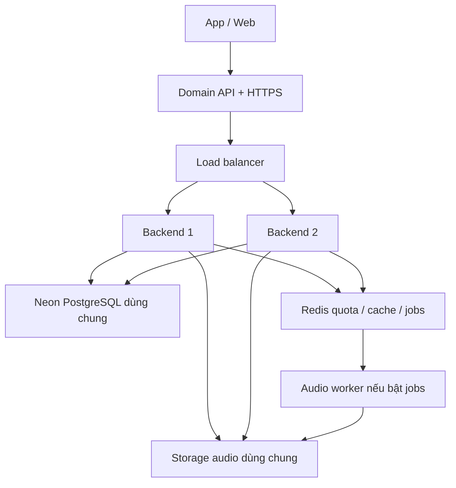

# Cuộc trò chuyện về cân bằng tải backend

- Ngày xuất: 10/11/2026
- Project: `speaking-ai-nextjs-backend`
- Phạm vi: Các yêu cầu và câu trả lời trao đổi với người dùng; không bao gồm chỉ dẫn hệ thống, ngữ cảnh tự động hoặc dữ liệu trả về từ công cụ.
- Các đường dẫn file được chuyển thành đường dẫn tương đối để thuận tiện đọc trong repository.

---

## 1. Triển khai cân bằng tải backend

### Người dùng

tôi muốn triển khai cân bằng tải backend thì sẽ triển khai như thế nào đối với project này

### Trợ lý — cập nhật tiến độ

Tôi sẽ xem cấu trúc backend, cách lưu session và các kết nối hiện tại để đề xuất phương án cân bằng tải phù hợp với project này.

Project đã có sẵn Docker Compose cho Nginx và hai backend ở cổng 3000/3001. Tôi đang kiểm tra phần dữ liệu dùng chung, vì đây là điều quyết định upload audio và xác thực có hoạt động đúng khi request đi sang backend khác hay không.

### Trợ lý — câu trả lời

**Với project này, bạn đã có sẵn cấu hình cân bằng tải Nginx → 2 backend Next.js.** Việc triển khai chủ yếu là chọn nơi chạy và cấu hình dữ liệu dùng chung.

Tôi đã xem Docker Compose, Nginx, Dockerfile và cấu hình Railway trong repo; chưa khởi chạy hoặc thay đổi hệ thống.

**1. Mô hình phù hợp**



Ví dụ: request tạo audio session vào backend 1, request upload chunk vào backend 2. Cả hai phải đọc được cùng session và audio.

**2. Nếu triển khai trên VPS bằng Docker**

Repo đã có:

| Thành phần | Cấu hình hiện tại |
|---|---|
| Nginx | Cổng host `8080` |
| Backend 1 | `backend-3000:3000` |
| Backend 2 | `backend-3001:3001` |
| Phân tải | `least_conn` — ưu tiên backend ít kết nối đang xử lý |
| Database | Neon PostgreSQL dùng chung |
| Redis | Ba instance riêng cho quota, cache, jobs |
| Worker | Tùy chọn, bật bằng profile `jobs` |

Cấu hình nằm ở [docker-compose.nginx.yml](../docker-compose.nginx.yml) và [nginx.conf](../infra/nginx/nginx.conf). Cách phân tải này phù hợp với các request audio có thời gian xử lý khác nhau. [Tài liệu Nginx](https://nginx.org/en/docs/http/load_balancing.html).

Sau khi điền đủ `.env.local`, chạy:

```powershell
npm run lb:up
npm run lb:status
npm run lb:check
```

Client gọi qua:

```text
http://127.0.0.1:8080/api/...
```

`lb:check` kiểm tra request đã được xử lý bởi ít nhất hai instance, đồng thời kiểm tra request ID, CORS và cache header. **Lệnh này chưa kiểm chứng luồng audio thực tế.**

Khi đưa lên server public:

- Trỏ domain API về server và cấu hình HTTPS.
- Mặc định Nginx chỉ bind `127.0.0.1`; cấu hình địa chỉ bind phù hợp với reverse proxy/firewall.
- Cập nhật `PWA_ALLOWED_ORIGINS` nếu frontend khác domain.
- Chỉ công khai cổng proxy; backend và Redis tiếp tục nằm trong mạng nội bộ.

Hướng dẫn có sẵn tại [nginx-load-balancer.md](nginx-load-balancer.md).

**3. Nếu triển khai trên Railway**

Bạn có thể dùng load balancer của Railway và chạy **hai replica của cùng web service**. Railway tự phân phối request giữa các replica. [Tài liệu Railway](https://docs.railway.com/deployments/optimize-performance).

Trong [railway.json](../railway.json), hiện cấu hình một replica tại Singapore. Để chạy hai replica, điều chỉnh phần tương ứng thành:

```json
"multiRegionConfig": {
  "asia-southeast1-eqsg3a": {
    "numReplicas": 2
  }
}
```

Giữ healthcheck `/api/ready`, dùng chung database, storage và secrets giữa các replica. Nếu bật jobs, triển khai worker thành service riêng theo [railway-deployment.md](railway-deployment.md).

**4. Những điểm cần giữ đúng trong project này**

- **Dữ liệu dùng chung:** dùng `PERSISTENCE_BACKEND=postgres`. Driver hiện tại yêu cầu Neon; không thay trực tiếp bằng URL PostgreSQL TCP bất kỳ.
- **Audio dùng chung:** bước đầu có thể dùng `AUDIO_STORAGE_BACKEND=postgres` và `AUDIO_SESSION_CHUNK_STORAGE_BACKEND=postgres`.
- **Secret đồng nhất:** các replica dùng cùng `INSTALLATION_AUTH_SECRET` và `AUDIO_UPLOAD_TOKEN_SECRET` nếu khai báo.
- **Quota đồng nhất:** khi bật Cloudflare pool, các replica phải dùng chung Redis quota và namespace. Thêm backend không tăng quota Cloudflare.
- **Jobs nhiều server:** dùng R2 chung. Volume `audio-job-files` hiện tại chỉ chia sẻ được giữa container trên cùng Docker host.
- **Cùng phiên bản:** chạy các replica từ cùng một image/build.

**Tôi đề xuất bắt đầu với hai replica trong cùng region, giữ Neon và storage chung, rồi đo tải audio thực tế.** Nếu chọn VPS, stack Nginx hiện có là điểm khởi đầu phù hợp; nếu chọn Railway, dùng replica của nền tảng. Hai container trên cùng VPS giúp chia tải và chịu lỗi một process, nhưng cả hệ thống vẫn phụ thuộc vào VPS đó.

---

## 2. Cách phát tải kiểm thử

### Người dùng

cần phát tải như thế nào

### Trợ lý — cập nhật tiến độ

Tôi hiểu “phát tải” là tạo nhiều request đồng thời để kiểm tra cân bằng tải. Tôi sẽ xem script benchmark có sẵn để chỉ đúng cách chạy và các chỉ số cần theo dõi.

### Trợ lý — câu trả lời

Nếu bạn nói **“phát tải” để kiểm thử backend chịu được bao nhiêu request**, project đã có runner sẵn. Nên gửi tải qua **Nginx cổng 8080**, để kiểm tra cả hai backend cùng lúc.

**1. Kiểm tra phân phối request trước**

```powershell
npm run lb:up
npm run lb:check
```

Bước này chỉ gọi health check, xác nhận cả hai backend nhận request.

**2. Phát tải audio tăng dần**

Bắt đầu với 2 client đồng thời:

```powershell
npm run benchmark:nginx -- --clients 2 --seconds 30 --max-requests 20
```

Sau đó tăng lần lượt, chạy riêng từng mức:

```powershell
npm run benchmark:nginx -- --clients 5 --seconds 30 --max-requests 50
npm run benchmark:nginx -- --clients 10 --seconds 30 --max-requests 100
npm run benchmark:nginx -- --clients 20 --seconds 30 --max-requests 120
```

`--clients 20` nghĩa là tối đa 20 luồng gửi đồng thời; mỗi luồng chờ response rồi gửi tiếp. **Không có nghĩa là 20 request/giây.** Runner ngừng gửi mới khi hết thời gian hoặc đạt giới hạn request, rồi chờ request đang chạy hoàn tất.

Để thử một đợt dồn 20 request:

```powershell
npm run benchmark:nginx -- --mode burst --clients 20 --max-requests 20
```

Các lệnh audio **gọi provider thật và sử dụng quota**. Nếu endpoint yêu cầu xác thực, cần token hợp lệ và `clientId` trong payload khớp token; runner hỗ trợ token qua biến `CLOUDFLARE_POOL_BENCHMARK_AUTH_TOKEN`.

**3. Theo dõi kết quả**

Mở terminal khác:

```powershell
npm run lb:logs:3000
npm run lb:logs:3001
```

Báo cáo JSON lưu trong thư mục `docs/postman/reports/`. Tập trung vào:

| Chỉ số | Cần đánh giá |
|---|---|
| `successRate` | Tỷ lệ request thành công |
| `successLatencyMs.p95` | 95% request thành công hoàn tất trong thời gian này |
| `successfulPerSecond` | Số request thành công mỗi giây |
| HTTP 429 | Đối chiếu `reason`/`stage` để biết giới hạn quota hoặc hàng chờ |
| HTTP 502/503/504 | Đối chiếu log backend, proxy và provider |
| CPU/RAM | Backend hay máy phát tải có bị bão hòa không |

Với `least_conn`, hai backend **không nhất thiết nhận đúng 50/50 request**; backend xử lý xong nhanh hơn có thể nhận thêm request.

Lưu ý: runner hiện dùng lại **cùng một audio**, nên cache có thể làm kết quả tốt hơn tải thực tế; nó cũng chỉ cho phép URL localhost. Để xác định năng lực production, cần thêm bài dùng nhiều audio khác nhau và chạy máy phát tải riêng.

---

## 3. Xuất cuộc trò chuyện

### Người dùng

hãy xuất cuộc trò chuyện này ra file md cho tôi

### Trợ lý — cập nhật tiến độ

Tôi sẽ xuất các tin nhắn của bạn và câu trả lời của tôi thành một file Markdown trong thư mục project.
